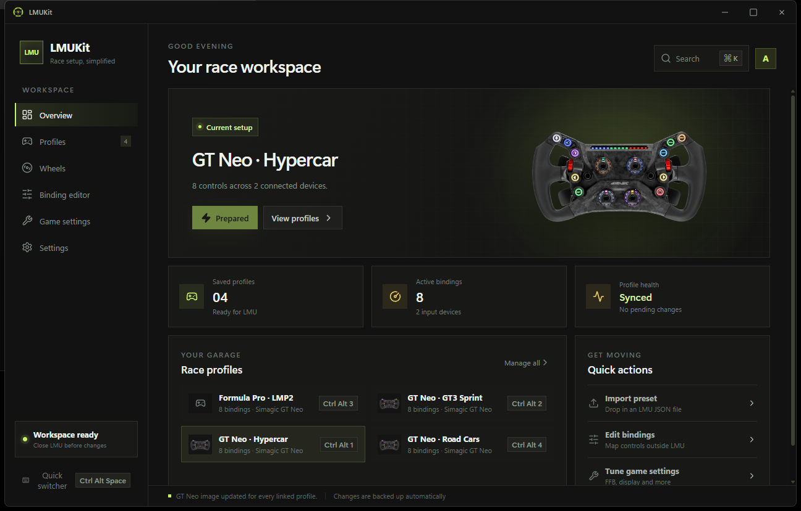
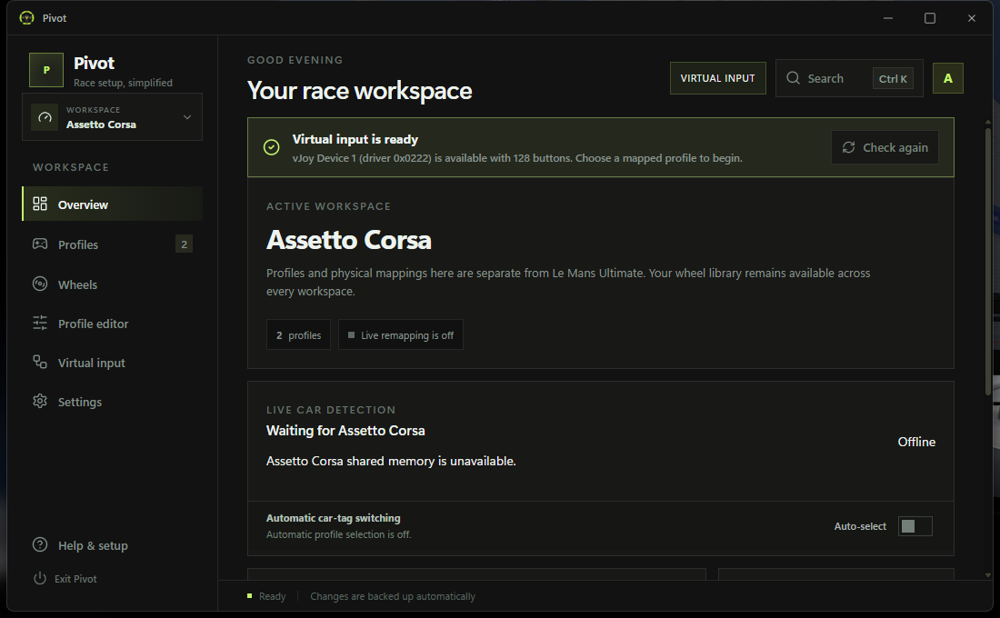

> [!WARNING]
> **Extensive AI usage disclosure:** Pivot is developed with extensive large-language-model assistance across product design, implementation, testing, documentation, and maintenance. The project is human-directed and changes are reviewed and tested before commit, but users should evaluate the software and its source with that development process in mind.

# Pivot

Pivot is a modern Windows toolkit for Le Mans Ultimate and button-only virtual remapping in Assetto Corsa. It brings isolated sim workspaces, binding profiles, reusable wheel metadata, control inspection, LMU game settings, and companion-app launching into one focused application.

Left-clicking the title-bar close button hides Pivot in the Windows notification area so live remapping can continue without a taskbar button. Right-click the close button to request a permanent exit. The tray shows the active workspace and live profile, and its menu provides **Show Pivot**, **Stop remapping**, and **Exit Pivot**. Exit always requires confirmation, stops routing, and releases virtual buttons before shutdown.

Pivot runs as a single instance. Launching it again restores the existing window instead of starting another input-routing process or tray icon.

Existing LMUKit installations upgrade in place: Pivot deliberately reuses the existing application identity and data directory, so profiles, wheels, mappings, settings, and backups remain available after the rename.




_The screenshot uses isolated synthetic profile data; no personal LMU files are included in the repository._



_Assetto Corsa keeps its profiles and named actions separate while reusing the global wheel library._

## Why use Pivot?

- Keep several wheel and car-class profiles without manually copying LMU configuration files.
- Reuse one stable set of LMU actions across interchangeable physical rims with Virtual Input Mode.
- Change button and encoder mappings per profile without rebinding every action in LMU.
- Use modifier combinations for actions such as VR recentering while preserving ordinary single-button actions.
- Find, test, and diagnose physical controls by their LMU action names instead of memorising virtual button numbers.
- Keep steering, pedals, and force feedback directly connected to LMU; virtual routing is deliberately button-only.
- Protect live and saved configuration with validation, explicit confirmation, and recovery backups.
- Launch LMU in Desktop or OpenXR mode together with the companion applications you choose.

## Current features

- Switch between isolated Le Mans Ultimate and Assetto Corsa workspaces. Existing profiles migrate to LMU automatically, while wheels and managed images remain shared.
- Capture LMU's live `direct input.json` as a named profile.
- Import validated preset JSON files by file picker or drag and drop.
- Activate a saved profile for LMU's next launch, always backing up the live file first.
- Detect when LMU's live bindings differ from the active saved profile and safely update either side.
- Organise profiles in a searchable two-pane workspace using reusable wheels, built-in WEC/ELMS class tags, and custom tags.
- Create a shared wheel library with brand, model, and managed PNG, JPEG, or WebP images. One wheel can be reused by several profiles.
- Browse bindings by device, add new LMU actions, replace primary/alternate mappings, clear unwanted mappings, and press or move a physical control to compare its mapping across every profile.
- Tune recognised force-feedback fields by device—including a friendly `0..100%` FFB gain control—and inspect the complete preserved profile JSON.
- Remove obsolete devices and all of their bindings from a saved profile after confirmation.
- Browse and edit LMU's `Settings.JSON`, including descriptions from matching `Option#` fields, while preserving unsupported JSON values.
- Assign `Ctrl+Alt+1` through `Ctrl+Alt+9` to profiles, open the compact switcher with `Ctrl+Alt+Space`, or search profiles with `Ctrl+K`.
- Configure Desktop or native OpenXR (`+XR`) launching and start Pivot, LMUFFB, Crew Chief, RaceLab, or custom companion applications through one explicit Steam launch option. Pivot validates enabled app entries before generating it, and each app starts in its own installation folder so relative profile and configuration files continue to work.
- Autosave LMU paths, launch mode, and companion-app setup.
- Follow an in-app Help & Setup guide for wheels, DirectInput-visible controllers, button boxes, Legacy JSON, Virtual Input, and common recovery steps.
- Scale the entire interface from Settings.
- Hide to the Windows notification area while live remapping continues, see the active workspace/profile in its tooltip, or stop remapping directly from the tray.
- Check vJoy capacity, workspace profiles, and the current route in a compact Overview health banner; starting a profile warns when one of its mapped physical devices is disconnected.
- Inspect virtual-input health and attached controllers, open rotating local logs, and export a privacy-redacted diagnostic report from Settings.
- Observe LMU's current player car, normalized class, session state, data source, and freshness on Overview through the game's read-only shared-memory interface.
- Guide one-time vJoy binding setup, save LMU's named action layout, learn and test physical buttons and modifier combinations per profile, warn before replacing conflicting mappings, configure digital encoder modes, assign one automatic default profile per car class, and switch experimental live DirectInput-to-vJoy routing without recreating the virtual controller.
- Name and pulse unused vJoy buttons for external tools such as RaceLab, then map those shared actions—with the same modifier support—independently in every profile.
- Deliberately make one physical button or modifier combination trigger several named actions—for example, recentering VR in both LMU and RaceLab—while retaining replacement warnings for accidental conflicts.

Pivot stores profiles, managed wheel images, settings, and timestamped recovery backups in the current Windows user's application-data directory. Use the **Folder** button on Profiles to open the exact location.

Virtual Input Mode is optional and requires the user to install and configure [vJoy](https://github.com/BrunnerInnovation/vJoy) separately. Pivot does not bundle, install, update, or silently reconfigure vJoy. Legacy JSON profile switching and the rest of Pivot remain usable without it.

## Using Pivot

### Workspaces and Assetto Corsa

Use the workspace selector below the Pivot logo to switch sims. Switching always stops live routing and releases every vJoy output first. Profiles, mappings, keyboard shortcuts, and the selected profile are shown for the active workspace; the wheel library remains shared.

Assetto Corsa uses the existing button-only Virtual Input engine and a one-time binding flow:

1. Select **Assetto Corsa** and create a profile under **Profiles**.
2. Assign a shared wheel, then open **Virtual input**.
3. Open **One-time Assetto Corsa button setup**, name and arm an action, make AC listen for input, then press `Ctrl+Alt+V`. Pivot sends the next unused vJoy button and saves that name after the pulse succeeds; confirm AC accepted it and repeat.
4. Open **Profile editor** and bind the physical wheel control to the named action.
5. Start that profile's live remapping from Profiles.
6. Add one or more exact tags from the car's `content/cars/<car-id>/ui/ui_car.json`, make the appropriate profile the default for each tag, and optionally enable **Auto-select** on the AC overview.

While AC is running, Pivot reads the active car ID from the documented `Local\acpmf_static` and `Local\acpmf_graphics` shared-memory pages, then reads that car's Content Manager tags from `ui_car.json`. Matching is case-insensitive but otherwise exact. If several matching tags point to different profile defaults, Pivot refuses to guess and asks for a more specific tag. Choose a non-default Steam library with the native folder picker under **Settings → Assetto Corsa installation**; Pivot verifies that the folder contains `acs.exe` and `content\cars` before saving it. Pivot never edits AC or Content Manager files and does not route axes or FFB; steering, pedals and force feedback stay directly connected to the game. Each workspace has an independent virtual action catalogue, so AC starts clean and LMU actions never leak into its profile editor.

### Profiles

Use the global **Input method** switch in the title bar to choose how profile selection behaves. **Legacy JSON** prepares a profile's `direct input.json` for LMU's next launch. **Virtual Input** makes profile selection start live physical-button-to-vJoy remapping instead. The choice persists; returning to Legacy JSON stops routing and releases every virtual button.

1. Close LMU before replacing its bindings.
2. Open **Settings** and confirm the paths to `direct input.json` and `Settings.JSON`.
3. Configure your controls in LMU, enter a profile name on **Profiles**, and choose **Capture LMU**.
4. Assign a reusable wheel and any relevant classes or tags in the selected profile's setup panel.
5. Choose **Use profile** to prepare those bindings for the next LMU launch.

LMU does not hot-reload `direct input.json`. Pivot therefore prepares the selected profile for the next launch; it does not claim to switch bindings inside a running session.

Before activating a Legacy profile or saving a live `Settings.JSON`, Pivot checks the Windows process list. If LMU is running, the write is cancelled by default and a clear confirmation explains that LMU may overwrite the file when it exits. Read-only profile capture and inspection are unaffected.

If LMU's live file intentionally differs while you are creating or rebinding another preset, dismiss the change notice. This hides the warning and its **Update from LMU** shortcut for the currently prepared profile until the active profile or synchronization state changes.

Existing presets can be dropped anywhere on the Profiles workspace. Imported JSON is validated before Pivot stores or activates it.

### Wheels and categories

Use **Wheels** to create reusable hardware entries, edit their brand and name, and add or replace their image. Profiles linked to that wheel share the same metadata and image throughout the app.

Each profile has one searchable tag picker. Select any combination of `LMGT3`, `GTE`, `LMP3`, `LMP2`, and `HY`, or type a custom tag. Leaving the class selection empty makes the profile generic. Existing data continues to store LMGT3 under the original `GT3` identifier so profiles and default references remain compatible.

### Profile editor

The **Profile editor** opens on the current Virtual Input mapping system, where each profile maps its physical buttons and modifiers to the stable named vJoy actions taught to LMU and other applications. The older saved-file workflow remains available under **LMU file tools** for Legacy mode: it includes device-grouped DirectInput binding management, force-feedback tuning, a read-only JSON preview, and live control lookup. Open a file binding's action menu to replace it or add its missing primary or alternate mapping, then press or move the desired control. **Add binding** can search action names found across your saved and live LMU files or accept an exact LMU action name. Pivot names any conflicts before applying the change and creates a recovery backup when saving.

**Find a wheel control** waits for a button, POV, or axis movement and then shows the matching action for each saved profile; the operation can be cancelled at any time. For safety, assignment only accepts devices already represented in that profile.

The force-feedback section discovers recognised numeric and boolean fields without inventing missing settings. Changes remain local until explicitly saved, and **Save & use profile** also prepares the edited profile for LMU's next launch. The JSON preview makes preserved device-specific and unknown fields auditable.

### Faster profile access

Open **Settings → Profile keyboard shortcuts** to assign `Ctrl+Alt+1` through `Ctrl+Alt+9`. Assignments are unique, so reusing a number moves it to the newly selected profile.

Press `Ctrl+Alt+Space` anywhere in Windows to open the compact profile switcher. In Legacy mode it prepares the selected JSON profile for LMU's next launch. In Virtual Input mode it changes the live remapping profile without replacing LMU's file. When live routing is active, **Disable remapping** is always available in the top bar.

### Virtual input setup

#### vJoy requirement and configuration

vJoy is required only for **Virtual Input Mode**. Install the signed Windows driver from the [BrunnerInnovation vJoy releases](https://github.com/BrunnerInnovation/vJoy/releases) and accept any administrator or restart prompts from its installer. Pivot deliberately does not bundle or install a controller driver.

Configure the virtual device before assigning it in LMU:

1. Close LMU and Pivot.
2. Open **Configure vJoy** from the Windows Start menu.
3. Select **device 1** and ensure that device is enabled.
4. Set **Buttons** to **128** and apply the configuration. Pivot does not require virtual axes or force feedback; it emits buttons only.
5. Restart Windows if requested, then open Pivot and check **Virtual input**. It should report vJoy device 1 with 128 buttons.

vJoy supports up to 128 buttons per device, and **128 is strongly recommended** so the shared action layout has room to grow. A smaller configuration still works, but Pivot can use only `B1` through the configured maximum: a 32-button device, for example, cannot route an action assigned to `B33`. Pivot reports the detected capacity, warns below 128, and rejects mappings outside it. The common eight-button default is therefore suitable only for a very small test layout.

Choose the button count once, before binding vJoy in LMU. Changing it alters the controller's HID descriptor, so Windows and LMU may enumerate it as a different device and the vJoy actions may need to be registered again. If the count is changed later, restart LMU and Pivot, rebind the affected actions once, and then keep the capacity fixed.

Steering, throttle, brake, clutch, and force feedback must stay bound directly to the physical wheelbase and pedals. Pivot neither routes nor suppresses axes or FFB. Avoid binding the same physical wheel buttons directly in LMU when Pivot is intended to route them, or both the physical and virtual devices may trigger actions.

#### Register LMU actions

Open **Virtual input**, start the guided binding setup, and leave LMU listening for the action you want to assign. Press `Ctrl+Alt+V` to send the next unused virtual button, or use the on-screen fallback. The shortcut is registered only while that setup session is active.

Pivot reserves each successfully emitted button for the rest of the session, so it advances safely even before LMU writes `direct input.json`. After assigning and saving the actions in LMU, choose **Finish & rescan**. Pivot validates and automatically saves the named layout when exactly one vJoy device has bindings. If LMU retains multiple vJoy incarnations after a device reconfiguration, Pivot asks the user to select the current device instead of guessing. Emitting a pulse is not treated as proof that LMU accepted it; the resulting action must appear in LMU's saved bindings.

This is a one-time LMU-side setup for each action: LMU learns that, for example, vJoy `B1` means Pit Limiter. Pivot records that action name, so daily profile editing is expressed as **physical control → Pit Limiter → B1**. Different profiles and rims can map different physical controls to Pit Limiter while LMU keeps the same `B1` assignment.

#### Register actions in other applications

The shared virtual layout can also contain user-named actions that do not belong to LMU. Under **Virtual input → External app actions**, enter a descriptive name such as `RaceLab — Recenter VR` and choose **Send & save action**. Pivot selects the next unused vJoy button, sends an initial test pulse, and adds that name to every profile mapping editor. Saved actions offer **Send now** for an already-open listener and a cancellable **In 5s** pulse for focus-sensitive applications: start the countdown, switch to Discord, and open Edit Keybind before it finishes. The delay runs outside the UI thread, so changing window focus does not stop it. An action cannot be removed while a profile still references it.

External actions use the same per-profile physical controls and modifier combinations as LMU actions. Live remapping must be stopped while registering or testing one because the routing engine owns the vJoy device. Only leave the intended target application listening—the vJoy button remains visible to LMU and other applications even when they have no binding for it.

#### Map and use profiles

Select a profile under **Profiles** and use the visible **Edit button mappings** action in its Virtual Input section. The dedicated mapping workspace can search or filter actions and convert saved LMU button assignments into virtual mappings by matching the LMU action name. Search accepts partial words in any order and also finds physical buttons, vJoy outputs, and device names. Pivot leaves manual mappings untouched and reports ambiguous controls for review. Choose **Bind control**, then press and release one button for a normal binding, or keep the first button held and press another to create a modifier combination. A normal and modified action may share the same trigger; the modified mapping takes precedence while its modifier is held.

Use **Test a control** in the same workspace to press a button or modifier combination and see every effective named action and vJoy output without changing the profile. The matching action rows are highlighted; unmapped controls are reported explicitly. Disable live remapping before testing so inspection cannot trigger an LMU action. Assigning a control that already belongs to another action shows the existing targets and asks whether to trigger both or replace the previous mapping.

Switch the global input method to **Virtual Input**, then choose **Use this profile live**. Profile keyboard shortcuts and the quick switcher follow the selected method: they prepare LMU's JSON in Legacy mode and switch live routing in Virtual mode. Virtual mode remains selected after restarting Pivot. Live routing stays stopped by default, or **Settings → Live profile startup** can explicitly restore the most recently used live profile when Pivot opens. Automatic startup never runs in Legacy JSON mode.

The same profile section can make a profile the single automatic default for each of its existing car-class tags. Defaults are global by class rather than scoped to a wheel: if a different rim is attached, select its profile manually. The **Virtual Input** page provides a quick class switcher and shows why the active profile was chosen. On Overview, **Auto-select** can opt into LMU class-based switching. Pivot requires two consecutive confirmed observations before applying that class's default, holds the current profile through unknown, stale, loading, and unsupported class states, and never guesses a fallback. Starting a profile manually or using a profile shortcut keeps that choice for the currently detected class, then automatically resumes selection when LMU confirms a different class. **Resume Auto** can discard that temporary override immediately. Disabling remapping pauses automation while routing is off; successfully starting a profile re-arms it without an extra step. Switching profiles validates the new mapping before releasing the previous route and does not recreate vJoy.

Profiles can also define digital rotary encoders through a guided Increase then Decrease capture flow. Capture starts automatically at each step; turn the encoder once, confirm it, and continue. A simple encoder needs only those two controls. Users can optionally add more named action modes and search the shared LMU action list for each assignment; adding a second mode also captures a separate button that cycles through them. The editor detects conflicts with other encoders, ordinary bindings, and modifiers before saving. The active mode is shown while routing. Encoder detents become bounded, serialised vJoy pulses with a guaranteed released gap, so rapid turns are queued instead of shortened or overlapped. Encoder controls cannot overlap ordinary profile bindings or another encoder. Pivot listens through DirectInput and translates only the selected profile's assigned buttons into vJoy outputs while it remains open. Disabling remapping, controller disconnection, errors, and normal app shutdown release held virtual outputs. Do not directly bind the same physical controls in LMU, because Pivot does not hide the physical controller.

Overview samples LMU's built-in shared memory every 1.5 seconds on a background thread and shows the confirmed player vehicle, existing profile class tag, session state, provenance, and freshness. Automatic class-aware profile selection is an explicit, persisted, default-off option. It changes only the in-memory Virtual Input route; it cannot run in Legacy mode or rewrite `direct input.json`. Its Simagic/vJoy and LMU transition behavior still requires hardware acceptance across menus, loading, replay, and live driving. Layers remain future work.

### Game settings

Open **Game settings** to search and edit LMU's `UserData/player/Settings.JSON`. Boolean, numeric, string, and nested values are supported, while matching `Option#` fields are shown as descriptions rather than duplicate settings.

Saving preserves unknown JSON data and creates a recovery backup first. Pivot warns and requires explicit confirmation if LMU is running because the game may overwrite its settings when it exits.

### LMU and companion apps

Open **Settings → LMU and companion apps**, choose **Desktop** or **VR (OpenXR)**, then add and enable the helpers you want. Paths, launch mode, and companion-app changes save automatically.

**Copy Steam launch option** creates Pivot's launcher and copies the command. Paste it into:

**Steam → Le Mans Ultimate → Properties → Launch Options**

VR mode passes LMU's native `+XR` argument. The launcher avoids opening duplicate Pivot or companion-app processes. Pivot never edits Steam configuration silently.

### Diagnostics and logs

Open **Settings → Diagnostics and logs** to check vJoy routing health, the active profile and input mode, and privacy-safe summaries of attached DirectInput controllers. The panel can open the log folder or export a diagnostic JSON report suitable for a bug report.

Pivot keeps date-named logs in its application-data `logs` folder. Entries use readable ISO-style UTC timestamps. Each file is capped at 2 MB, with at most three same-day segments, so repeated failures cannot grow storage without bound. Logs are retained for five days by default; change the period from 1 to 30 days in the diagnostics panel. Normal logs record application and routing lifecycle events, not individual button presses. Exported reports omit configured filesystem paths and DirectInput device-instance identifiers; review any report before sharing it.

## Development

The primary runtime is Windows, while development commonly happens in WSL. The desktop shell uses Tauri 2, the interface uses React and TypeScript, and compatibility-sensitive storage behavior lives in the independent `lmukit-core` Rust crate.

The repository uses [mise](https://mise.jdx.dev/) to pin Rust, Node.js, pnpm, and the supported commands:

```sh
mise trust
mise install
pnpm install
mise run dev
```

| Command          | Purpose                                                  |
| ---------------- | -------------------------------------------------------- |
| `mise run dev`   | Cross-build and launch the Windows debug app from WSL    |
| `mise run build` | Build the frontend and Windows x86-64 release executable |
| `mise run test`  | Run context, core, and virtual-backend tests             |
| `mise run check` | Check context, core, and virtual-backend crates          |
| `mise run fmt`   | Check Rust formatting                                    |
| `mise run lint`  | Run Clippy with warnings denied                          |
| `pnpm build`     | Type-check and build the React interface                 |

`mise run build-virtual-probe` cross-builds the isolated, experimental Windows vJoy feasibility probe. It is not part of the production app or release packages and does not install a driver. vJoy remains an explicit user-installed dependency required only for Virtual Input Mode. The tested compatibility scope and remaining hardware gates are recorded in the [feasibility report](docs/virtual-input-feasibility.md). The intended one-time LMU setup, stable virtual layout, profile mappings, and daily workflow are documented in the [Virtual Input profile model](docs/virtual-input-mode.md).

`mise run build-context-probe` cross-builds the read-only LMU car-context probe. It opens LMU's built-in `LMU_Data` mapping under the official shared lock and prints the confirmed player vehicle, raw and normalized class, session state, provenance, and observation time. It does not install a legacy rFactor 2 plugin or write to the game.

Research for future native VR widgets—including standings, session weather forecasts, and pedal traces—is recorded in the [native OpenXR overlay design note](docs/native-openxr-overlays.md). The proposed path is a Pivot-owned OpenXR API layer and native renderer, with no OpenKneeboard or browser-overlay dependency. It remains gated on an in-game static-quad, runtime, performance, and anti-cheat feasibility test and is not a current feature.

Use `LMUKIT_DATA_DIR` with an isolated directory for screenshots and manual tests. Never test development builds against personal profiles or live Windows application data.

Before handing off a code change, run:

```sh
cargo fmt --all --check
cargo test -p lmukit-context
cargo clippy -p lmukit-context --all-targets --all-features -- -D warnings
cargo test -p lmukit-core
cargo clippy -p lmukit-core --all-targets --all-features -- -D warnings
cargo test -p lmukit-virtual
cargo clippy -p lmukit-virtual --all-targets --all-features -- -D warnings
pnpm build
cargo xwin check -p lmukit --target x86_64-pc-windows-msvc
cargo xwin check -p lmukit-context --target x86_64-pc-windows-msvc
cargo xwin check -p lmukit-virtual --target x86_64-pc-windows-msvc
cargo xwin test -p lmukit-context --target x86_64-pc-windows-msvc --no-run
cargo xwin test -p lmukit-virtual --target x86_64-pc-windows-msvc --no-run
```

Repository architecture, data-format invariants, and guidance for human and AI-assisted contributors are maintained in [AGENTS.md](AGENTS.md).

## Releases

Pushing a tag matching `v*` runs the Windows release workflow. The tag version must match the Cargo and Tauri package versions. After all formatting, test, lint, frontend, and Windows build checks pass, GitHub Actions creates a release containing:

- a portable Windows x86-64 ZIP;
- the Tauri NSIS installer;
- SHA-256 checksum files for both packages.

```sh
git tag v0.4.6
git push origin v0.4.6
```

## AI-assisted development

Large language models are used extensively in Pivot's development—not merely for occasional completion. They assist with architecture exploration, UI and product iteration, Rust and TypeScript implementation, test creation, debugging, documentation, and repository maintenance.

The human maintainer directs the product, reviews changes, runs the required checks, and decides what is committed and released. Even with that review, AI-assisted work can contain mistakes or incorrect assumptions. Issues and code review are welcome, and the repository history is intentionally kept in small, descriptive commits to make the work auditable.

## Planned work

- Extend hardware and disconnect/reconnect acceptance beyond the recorded Simagic/vJoy environment for [Virtual Input Mode](docs/virtual-input-mode.md). The passed driving-session scope and remaining portability limits are documented in the [feasibility report](docs/virtual-input-feasibility.md).
- Validate automatic class selection across LMU menu, loading, replay, session, game-update, and disconnect transitions using the installed native shared-memory contract; no REST endpoint is assumed.

## License

MIT
