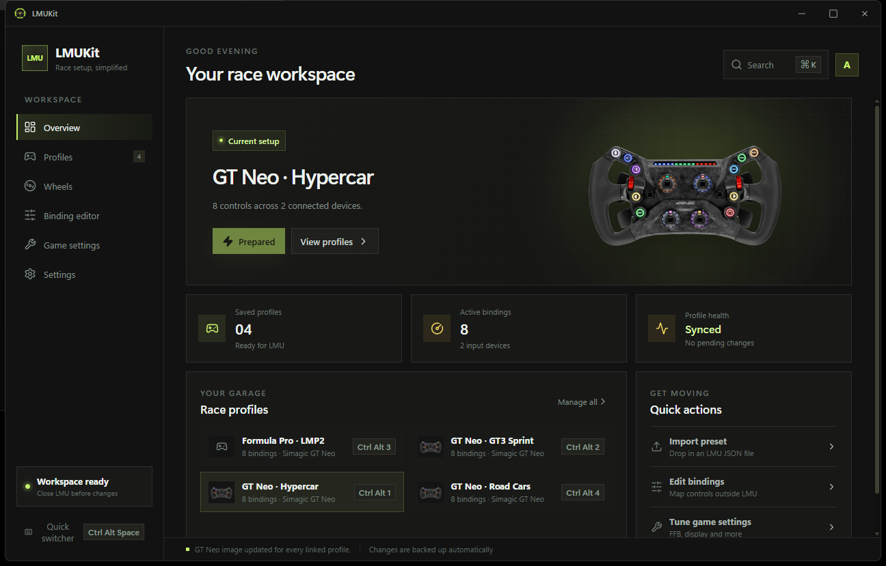

> [!WARNING]
> **Extensive AI usage disclosure:** LMUKit is developed with extensive large-language-model assistance across product design, implementation, testing, documentation, and maintenance. The project is human-directed and changes are reviewed and tested before commit, but users should evaluate the software and its source with that development process in mind.

# LMUKit

LMUKit is a modern Windows toolkit for Le Mans Ultimate. It brings binding profiles, reusable wheel metadata, control inspection, game settings, and companion-app launching into one focused race workspace.

Closing the main window minimizes LMUKit to the Windows taskbar so live remapping can continue. Use **Exit LMUKit** at the bottom of the sidebar to stop routing, release virtual buttons, and fully quit.




_The screenshot uses isolated synthetic profile data; no personal LMU files are included in the repository._

## Current features

- Capture LMU's live `direct input.json` as a named profile.
- Import validated preset JSON files by file picker or drag and drop.
- Activate a saved profile for LMU's next launch, always backing up the live file first.
- Detect when LMU's live bindings differ from the active saved profile and safely update either side.
- Organise profiles in a searchable two-pane workspace using reusable wheels, built-in WEC/ELMS class tags, and custom tags.
- Create a shared wheel library with brand, model, and managed PNG, JPEG, or WebP images. One wheel can be reused by several profiles.
- Browse bindings by device, add new LMU actions, replace primary/alternate mappings, clear unwanted mappings, and press or move a physical control to compare its mapping across every profile.
- Tune recognised force-feedback fields by device—including a friendly `0..100%` FFB gain control—and inspect the complete preserved profile JSON.
- Remove obsolete devices and all of their bindings from a saved profile after confirmation.
- Browse and edit LMU's `Settings.JSON`, including descriptions from matching `Option#` fields, while preserving unsupported JSON values.
- Assign `Ctrl+Alt+1` through `Ctrl+Alt+9` to profiles, open the compact switcher with `Ctrl+Alt+Space`, or search profiles with `Ctrl+K`.
- Configure Desktop or native OpenXR (`+XR`) launching and start LMUKit, LMUFFB, Crew Chief, RaceLab, or custom companion applications through one explicit Steam launch option.
- Autosave LMU paths, launch mode, and companion-app setup.
- Scale the entire interface from Settings.
- Inspect virtual-input health and attached controllers, open rotating local logs, and export a privacy-redacted diagnostic report from Settings.
- Guide one-time vJoy binding setup, save LMU's named button layout, learn physical buttons and modifier combinations per profile, assign wheel/class defaults, and switch experimental live DirectInput-to-vJoy routing without recreating the virtual controller.

LMUKit stores profiles, managed wheel images, settings, and timestamped recovery backups in the current Windows user's application-data directory. Use the **Folder** button on Profiles to open the exact location.

Virtual Input Mode is optional and requires the user to install and configure [vJoy](https://github.com/BrunnerInnovation/vJoy) separately. LMUKit does not bundle, install, or update vJoy. Legacy JSON profile switching does not require it.

## Using LMUKit

### Profiles

Use the global **Input method** switch in the title bar to choose how profile selection behaves. **Legacy JSON** prepares a profile's `direct input.json` for LMU's next launch. **Virtual Input** makes profile selection start live physical-button-to-vJoy remapping instead. The choice persists; returning to Legacy JSON stops routing and releases every virtual button.

1. Close LMU before replacing its bindings.
2. Open **Settings** and confirm the paths to `direct input.json` and `Settings.JSON`.
3. Configure your controls in LMU, enter a profile name on **Profiles**, and choose **Capture LMU**.
4. Assign a reusable wheel and any relevant classes or tags in the selected profile's setup panel.
5. Choose **Use profile** to prepare those bindings for the next LMU launch.

LMU does not hot-reload `direct input.json`. LMUKit therefore prepares the selected profile for the next launch; it does not claim to switch bindings inside a running session.

If LMU's live file intentionally differs while you are creating or rebinding another preset, dismiss the change notice. This hides the warning and its **Update from LMU** shortcut for the currently prepared profile until the active profile or synchronization state changes.

Existing presets can be dropped anywhere on the Profiles workspace. Imported JSON is validated before LMUKit stores or activates it.

### Wheels and categories

Use **Wheels** to create reusable hardware entries, edit their brand and name, and add or replace their image. Profiles linked to that wheel share the same metadata and image throughout the app.

Each profile has one searchable tag picker. Select any combination of `GT3`, `GTE`, `LMP3`, `LMP2`, and `HY`, or type a custom tag. Leaving the class selection empty makes the profile generic.

### Profile editor

The **Profile editor** provides device-grouped binding management, force-feedback tuning, a read-only JSON preview, and live control lookup. Open a binding's action menu to replace it or add its missing primary or alternate mapping, then press or move the desired control. **Add binding** can search action names found across your saved and live LMU files or accept an exact LMU action name. LMUKit names any conflicts before applying the change and creates a recovery backup when saving.

**Find a wheel control** waits for a button, POV, or axis movement and then shows the matching action for each saved profile; the operation can be cancelled at any time. For safety, assignment only accepts devices already represented in that profile.

The force-feedback section discovers recognised numeric and boolean fields without inventing missing settings. Changes remain local until explicitly saved, and **Save & use profile** also prepares the edited profile for LMU's next launch. The JSON preview makes preserved device-specific and unknown fields auditable.

### Faster profile access

Open **Settings → Profile keyboard shortcuts** to assign `Ctrl+Alt+1` through `Ctrl+Alt+9`. Assignments are unique, so reusing a number moves it to the newly selected profile.

Press `Ctrl+Alt+Space` anywhere in Windows to open the compact profile switcher. These shortcuts still prepare a profile for LMU's next launch; they do not alter a running LMU session.

### Virtual input setup

Virtual Input Mode requires vJoy device 1 to be installed and configured separately. Open **Configure vJoy**, select device 1, set **Buttons** to **128**, and apply the change before opening LMU and LMUKit. The common eight-button configuration is not enough for a useful LMU action layout; LMUKit reports the device's actual capacity and warns when it is below 128. Changing the capacity alters the HID descriptor and may cause Windows to re-enumerate the controller, requiring existing LMU vJoy assignments to be registered again once. Restart both apps after applying the change and then leave the device at 128 buttons.

Open **Virtual input**, start the guided binding setup, and leave LMU listening for the action you want to assign. Press `Ctrl+Alt+V` to send the next unused virtual button, or use the on-screen fallback. The shortcut is registered only while that setup session is active.

LMUKit reserves each successfully emitted button for the rest of the session, so it advances safely even before LMU writes `direct input.json`. After assigning and saving the actions in LMU, choose **Finish & rescan**. LMUKit validates and automatically saves the named layout when exactly one vJoy device has bindings. If LMU retains multiple vJoy incarnations after a device reconfiguration, LMUKit asks the user to select the current device instead of guessing. Emitting a pulse is not treated as proof that LMU accepted it; the resulting action must appear in LMU's saved bindings.

Select a profile under **Profiles** and use the visible **Edit button mappings** action in its Virtual Input section. The dedicated mapping workspace can search or filter actions and convert saved LMU button assignments into virtual mappings by matching the LMU action name. Search accepts partial words in any order and also finds physical buttons, vJoy outputs, and device names. LMUKit leaves manual mappings untouched and reports ambiguous controls for review. Choose **Bind control**, then press and release one button for a normal binding, or keep the first button held and press another to create a modifier combination. A normal and modified action may share the same trigger; the modified mapping takes precedence while its modifier is held.

Use **Test a control** in the same workspace to press a button or modifier combination and see the effective named action and vJoy output without changing the profile. The matching action row is highlighted; unmapped controls are reported explicitly. Disable live remapping before testing so inspection cannot trigger an LMU action. Assigning a control that already belongs to another action shows both actions and requires explicit confirmation before replacing the existing mapping.

Switch the global input method to **Virtual Input**, then choose **Use this profile live**. Profile keyboard shortcuts and the quick switcher follow the selected method: they prepare LMU's JSON in Legacy mode and switch live routing in Virtual mode. Virtual mode remains selected after restarting LMUKit. Live routing stays stopped by default, or **Settings → Live profile startup** can explicitly restore the most recently used live profile when LMUKit opens. Automatic startup never runs in Legacy JSON mode.

The same profile section can make a profile the default for each of its existing car-class tags or the wheel's fallback for other classes. The **Virtual Input** page provides a quick wheel-and-class switcher, resolves the exact class default before the fallback, and shows why the active profile was chosen. A manual profile started from its detail pane remains active until explicitly changed or stopped. Switching profiles validates the new mapping before releasing the previous route and does not recreate vJoy.

Profiles can also define digital rotary encoders through a guided Increase then Decrease capture flow. Capture starts automatically at each step; turn the encoder once, confirm it, and continue. A simple encoder needs only those two controls. Users can optionally add more named action modes and search the shared LMU action list for each assignment; adding a second mode also captures a separate button that cycles through them. The editor detects conflicts with other encoders, ordinary bindings, and modifiers before saving. The active mode is shown while routing. Encoder detents become bounded, serialised vJoy pulses with a guaranteed released gap, so rapid turns are queued instead of shortened or overlapped. Encoder controls cannot overlap ordinary profile bindings or another encoder. LMUKit listens through DirectInput and translates only the selected profile's assigned buttons into vJoy outputs while it remains open. Disabling remapping, controller disconnection, errors, and normal app shutdown release held virtual outputs. Do not directly bind the same physical controls in LMU, because LMUKit does not hide the physical controller. Layers and automatic LMU car detection are not yet implemented.

### Game settings

Open **Game settings** to search and edit LMU's `UserData/player/Settings.JSON`. Boolean, numeric, string, and nested values are supported, while matching `Option#` fields are shown as descriptions rather than duplicate settings.

Saving preserves unknown JSON data and creates a recovery backup first. Close LMU before saving because the game may overwrite its settings while running.

### LMU and companion apps

Open **Settings → LMU and companion apps**, choose **Desktop** or **VR (OpenXR)**, then add and enable the helpers you want. Paths, launch mode, and companion-app changes save automatically.

**Copy Steam launch option** creates LMUKit's launcher and copies the command. Paste it into:

**Steam → Le Mans Ultimate → Properties → Launch Options**

VR mode passes LMU's native `+XR` argument. The launcher avoids opening duplicate LMUKit or companion-app processes. LMUKit never edits Steam configuration silently.

### Diagnostics and logs

Open **Settings → Diagnostics and logs** to check vJoy routing health, the active profile and input mode, and privacy-safe summaries of attached DirectInput controllers. The panel can open the log folder or export a diagnostic JSON report suitable for a bug report.

LMUKit keeps one date-named log per local calendar day in its application-data `logs` folder. Entries use readable ISO-style UTC timestamps. Logs are retained for five days by default; change the period from 1 to 30 days in the diagnostics panel. Normal logs record application and routing lifecycle events, not individual button presses. Exported reports omit configured filesystem paths and DirectInput device-instance identifiers; review any report before sharing it.

## Development

The primary runtime is Windows, while development commonly happens in WSL. The desktop shell uses Tauri 2, the interface uses React and TypeScript, and compatibility-sensitive storage behavior lives in the independent `lmukit-core` Rust crate.

The repository uses [mise](https://mise.jdx.dev/) to pin Rust, Node.js, pnpm, and the supported commands:

```sh
mise trust
mise install
pnpm install
mise run dev
```

| Command          | Purpose                                                  |
| ---------------- | -------------------------------------------------------- |
| `mise run dev`   | Cross-build and launch the Windows debug app from WSL    |
| `mise run build` | Build the frontend and Windows x86-64 release executable |
| `mise run test`  | Run core and virtual-backend tests                       |
| `mise run check` | Check core and virtual-backend crates                    |
| `mise run fmt`   | Check Rust formatting                                    |
| `mise run lint`  | Run Clippy with warnings denied                          |
| `pnpm build`     | Type-check and build the React interface                 |

`mise run build-virtual-probe` cross-builds the isolated, experimental Windows vJoy feasibility probe. It is not part of the production app or release packages and does not install a driver. vJoy remains an explicit user-installed dependency required only for Virtual Input Mode. The tested compatibility scope and remaining hardware gates are recorded in the [feasibility report](docs/virtual-input-feasibility.md). The intended one-time LMU setup, stable virtual layout, profile mappings, and daily workflow are documented in the [Virtual Input profile model](docs/virtual-input-mode.md).

Use `LMUKIT_DATA_DIR` with an isolated directory for screenshots and manual tests. Never test development builds against personal profiles or live Windows application data.

Before handing off a code change, run:

```sh
cargo fmt --all --check
cargo test -p lmukit-core
cargo clippy -p lmukit-core --all-targets --all-features -- -D warnings
cargo test -p lmukit-virtual
cargo clippy -p lmukit-virtual --all-targets --all-features -- -D warnings
pnpm build
cargo xwin check -p lmukit --target x86_64-pc-windows-msvc
cargo xwin check -p lmukit-virtual --target x86_64-pc-windows-msvc
```

Repository architecture, data-format invariants, and guidance for human and AI-assisted contributors are maintained in [AGENTS.md](AGENTS.md).

## Releases

Pushing a tag matching `v*` runs the Windows release workflow. The tag version must match the Cargo and Tauri package versions. After all formatting, test, lint, frontend, and Windows build checks pass, GitHub Actions creates a release containing:

- a portable Windows x86-64 ZIP;
- the Tauri NSIS installer;
- SHA-256 checksum files for both packages.

```sh
git tag v0.4.0
git push origin v0.4.0
```

## AI-assisted development

Large language models are used extensively in LMUKit's development—not merely for occasional completion. They assist with architecture exploration, UI and product iteration, Rust and TypeScript implementation, test creation, debugging, documentation, and repository maintenance.

The human maintainer directs the product, reviews changes, runs the required checks, and decides what is committed and released. Even with that review, AI-assisted work can contain mistakes or incorrect assumptions. Issues and code review are welcome, and the repository history is intentionally kept in small, descriptive commits to make the work auditable.

## Planned work

- Develop an experimental [Virtual Input Mode](docs/virtual-input-mode.md) without replacing the existing, backed-up JSON profile workflow. The repository audit, candidate-driver constraints, LMU compatibility gate, and phased plan are documented in the [feasibility report](docs/virtual-input-feasibility.md).
- Verify LMU's current native shared-memory contract from the header shipped with an installed game build before implementing automatic vehicle/class detection; no REST endpoint or memory layout is assumed.

## License

MIT
