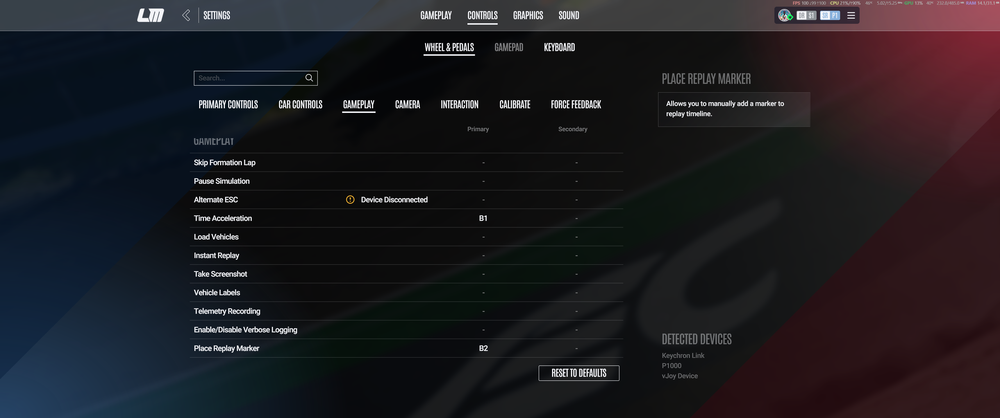

# Virtual Input Mode: audit and feasibility gate

Status: **end-to-end Simagic button routing into LMU passed; restart stability and driving-session non-interference pending**
Audit date: 2026-10-11

This document records the repository audit and the evidence required before LMUKit can describe Virtual Input Mode as compatible with LMU. The first implementation phase is deliberately isolated from the production UI and persistence model. It does not install a driver, alter LMU files, suppress physical controls, or replace the existing JSON profile-switching workflow.

The stable virtual layout, profile responsibilities, one-time LMU binding setup, and daily workflow are defined in the [Virtual Input profile model](virtual-input-mode.md).

## Repository audit

LMUKit currently has one production operating model: a saved profile owns a validated copy of LMU's `direct input.json`, and activating it prepares that file for LMU's next launch. `lmukit-core` validates JSON and creates a timestamped recovery backup before replacing a live configuration. LMU does not hot-reload that file, so the existing restart guidance remains correct.

The current data model already supports the product concepts that should be reused:

- Profiles retain their UUID, name, settings, bindings, reusable `wheel_id`, and independent `class_tags` and `custom_tags`.
- A profile can carry several existing class tags. The built-in UI choices are `GT3`, `GTE`, `LMP3`, `LMP2`, and `HY`; an empty class list means generic.
- Several profiles can already reference the same reusable wheel, including several profiles for the same class.
- Legacy wheel metadata is migrated additively by matching brand and wheel name. Settings and profile additions use Serde defaults so older JSON remains readable.
- Physical input learning uses Windows `RawGameController`. Each capture listener starts on a fresh OS thread to avoid conflicting with the webview's WinRT apartment mode.

The repository now has an experimental continuous DirectInput press/release monitor, virtual-output backend, stable layout, persisted per-profile button, modifier, and encoder-mode mappings, wheel/class default references with fallbacks, and manual start/stop or default-based routing. It does not yet have layers, a car-context provider, or a reliable automatic rim identity provider. The legacy Windows Gaming Input learner remains separate from the DirectInput routing path.

### Existing class IDs and proposed context aliases

The stored IDs remain the existing `GT3`, `GTE`, `LMP3`, `LMP2`, and `HY` values. A future context provider may compare a conservative alias to those IDs, but must not rewrite a profile's stored tags merely because an alias was observed.

| Observed value   | Existing class ID | Rule                                                           |
| ---------------- | ----------------- | -------------------------------------------------------------- |
| `GT3`, `LMGT3`   | `GT3`             | `LMGT3` is the current championship name for the GT3 category. |
| `GTE`            | `GTE`             | Kept distinct from GT3 for saved historic/content profiles.    |
| `LMP3`, `LMP 3`  | `LMP3`            | Whitespace-only spelling alias.                                |
| `LMP2`, `LMP 2`  | `LMP2`            | Whitespace-only spelling alias.                                |
| `HY`, `Hypercar` | `HY`              | Friendly spelling alias for the existing Hypercar tag.         |

Matching should be case-insensitive and trim surrounding whitespace. Values such as `LMH`, `LMDh`, `GTP`, manufacturer names, and model identifiers remain **unknown** until actual LMU payloads establish their semantics; they must not be guessed into `HY`. Unknown or ambiguous values never cause an automatic profile change.

### Migration risks and intended boundaries

No persisted schema changes are part of the feasibility spike. Later phases should use additive, defaulted data and keep virtual configuration separate from transient device state:

- wheel/class defaults must be references keyed by wheel ID and a normalised existing class identifier, not an `is_default` flag on a profile;
- wheel fallback and explicit manual override must also be references and must be repaired or rejected when a wheel/profile is deleted;
- existing `class_tags` remain authoritative—there will not be a second class-tag system;
- old JSON profiles must never be silently treated as complete virtual mappings;
- virtual button ranges and references must be validated during load/import;
- switching operating modes must release virtual outputs but must not rewrite LMU bindings without the existing explicit, backed-up legacy operation.

## Virtual-device candidate

The initial candidate was the [BrunnerInnovation vJoy fork](https://github.com/BrunnerInnovation/vJoy), used through its documented native interface. Its repository is MIT licensed and describes Windows 10/11 support. Its 2.2.2.0 release states that the driver and installer are Microsoft-attestation signed. The public API exposes acquisition, release, button-count queries, button state, and reset operations; its current public header permits up to 16 devices and 128 buttons per device.

This is a feasibility choice, not an endorsement or compatibility claim. The maintainer describes the fork as sponsored signing work rather than active feature development. LMUKit does not redistribute or silently install vJoy in this phase. Installation and device configuration require explicit user action and any administrator consent requested by the driver's installer.

### Recorded vJoy result

The Windows DirectInput gate passed on 2026-10-11. vJoy 2.2.2.0 eventually registered after a prolonged installer flow and reboot. Windows reported the vJoy driver and HID device as healthy, and LMUKit acquired device 1 with eight configured buttons. Early visual tests were unreliable: transient pulses were missed in `joy.cpl`, while vJoy's own Feeder left two buttons held after exit. This was not evidence of multi-second vJoy latency.

LMUKit's automated verifier subsequently drove each button through the vJoy API and read it back through an independent DirectInput consumer. Button 1 press/release appeared after 1.52/1.49 ms and button 2 after 1.52/1.47 ms. The verifier also confirmed both buttons released after disconnect. This establishes working low-latency DirectInput output and cleanup on this machine.

LMU v1.4200 then detected `vJoy Device` and accepted controlled outputs as `B1` and `B2` for two separate bindings. This establishes that the current LMU build enumerates this vJoy configuration and can learn its button outputs.



The recorded environment was vJoy 2.2.2.0, vJoy device 1 configured with eight buttons, LMU v1.4200, and Windows build 26300.9550 (26H2). The initial binding-capture actions shown above were Time Acceleration (`B1`) and Place Replay Marker (`B2`). Both outputs were released by the probe after a 1.5-second hold.

The end-to-end test used a `SIMAGIC Alpha EVO Wheelbase` exposing 116 DirectInput buttons. Windows Gaming Input did not enumerate the wheelbase, so the probe used the DirectInput source adapter. Physical buttons 1 and 2 produced matched vJoy press/release events, and the user confirmed that LMU responded in a replay through the rebound Driving Cameras (`B1`) and Spectator Cameras (`B2`) actions. Rapid repeated button 2 events were delivered, and the probe cleared all virtual outputs when its bounded run ended. This confirms the smallest physical-button -> virtual-button -> live LMU action pipeline on this machine. It does not yet establish non-interference with the direct steering/FFB path in a driving session, identity stability after restarts, or reliable persisted profile remapping.

Virtual Input Mode is intentionally button-only. Steering, throttle, brake, clutch, and FFB always remain direct between the physical hardware and LMU. LMUKit must not read or emit those axes, transform or suppress them, or participate in force-feedback delivery. Device discovery may report axis capability metadata, and a platform API may require ignored axis buffers while reading buttons, but axes never enter the mapping pipeline. Editing LMU's saved FFB configuration values remains an independent legacy profile/settings feature.

Windows `RawGameController` did not enumerate either this vJoy device or the active Simagic wheelbase. That means the existing WGI-based physical-input reader is insufficient for this hardware; the production routing engine needs a DirectInput physical adapter. LMU's successful binding test confirms LMU is not limited to that same enumeration path. One additional inactive/unknown vJoy driver node appeared after reboot, and the difficult installer experience remains a product/distribution concern. Do not weaken Windows security settings. The adapter remains isolated and experimental until the remaining restart-stability and driving-session gates pass.

[ViGEmBus](https://docs.nefarius.at/projects/ViGEm/End-of-Life/) is not the selected backend: it is retired and emulates a small set of console gamepads rather than a generic high-button-count DirectInput joystick. Writing or bundling a custom kernel driver is outside LMUKit's current safety and maintenance boundary.

The adapter is intentionally replaceable. Its contract is limited to connecting, reporting capabilities and identity, setting a button, releasing all buttons, and disconnecting. A mock implementation is used for deterministic tests.

Build the isolated Windows probe from WSL with:

```sh
mise run build-virtual-probe
```

The executable is written to `target/x86_64-pc-windows-msvc/debug/lmukit-virtual-probe.exe`. Run it from Windows PowerShell using its Windows/UNC path:

```powershell
lmukit-virtual-probe.exe list
lmukit-virtual-probe.exe directinput-list
lmukit-virtual-probe.exe pulse 1 1500
lmukit-virtual-probe.exe button 1 1 1500
lmukit-virtual-probe.exe verify 1 1
lmukit-virtual-probe.exe mirror 1 0 30
lmukit-virtual-probe.exe directinput-mirror 1 0 30
```

`list` shows privacy-safe Windows Gaming Input controller metadata and a temporary selection index. `directinput-list` independently enumerates the DirectInput consumer view. `pulse` presses and releases virtual buttons 1 and 2, holding each for 1.5 seconds by default so the state is visible in Windows' controller panel. `button` emits one chosen button for controlled in-game binding tests. `verify` drives buttons 1 and 2 through vJoy and reads every press, release, and final cleanup state back through DirectInput, failing if a transition is not observed within two seconds. `mirror` routes physical buttons 1 and 2 from the selected Windows Gaming Input controller to the same stable virtual outputs for a bounded duration. `directinput-mirror` performs the same bounded test with a physical DirectInput controller and refuses to select vJoy itself as the source. Normal completion and Ctrl+C release every output before disconnecting. Device-instance identifiers are used only in memory to survive Windows Gaming Input enumeration-order changes and are not printed. DirectInput indices are temporary and must be checked immediately before a test. The probe virtualises no axes and never writes LMU configuration.

## LMU compatibility gate

Windows recognising vJoy does **not** prove that LMU will expose or accept it. Before this integration can leave experimental status, a real Windows/LMU test must establish all of the following:

1. Install the signed vJoy release manually and configure device 1 with at least two buttons.
2. Run `lmukit-virtual-probe.exe directinput-list`, locate vJoy's index, then run `lmukit-virtual-probe.exe verify 1 <index>`. Require observed press/release pairs and clean disconnect. `pulse 1 1500` plus Windows controller properties (`joy.cpl`) remains an optional visual check.
3. **Passed on 2026-10-11:** LMU v1.4200 detected `vJoy Device` and registered buttons 1 and 2 as `B1` and `B2`.
4. **Button route passed on 2026-10-11:** `directinput-mirror` routed buttons 1 and 2 from the Simagic Alpha EVO Wheelbase through stable vJoy outputs, and LMU changed the bound replay camera actions. A driving-session test must still confirm that this separate button route does not interfere with direct steering or FFB.
5. Restart LMUKit, then LMU, without recreating or reconfiguring the virtual device. Record the displayed device identity and confirm the bindings remain valid.
6. Change only the probe mapping/profile and confirm that the same virtual device and LMU bindings continue to work without restarting LMU.
7. Confirm that direct physical button bindings can coexist and document how users avoid accidental duplicate bindings. LMUKit does not hide or suppress the physical device.

Record the vJoy version, Windows version, LMU version, virtual device ID/button count, and the result of every step. The button-routing compatibility demonstrated here may be reported with this exact tested scope, but the backend must remain clearly labelled experimental until the remaining steps pass.

## LMU car-context investigation

No selected-player vehicle/class REST endpoint has yet been verified from an authoritative LMU schema. LMU's official broadcast-overlay guide documents a local web service on port 6397, but that alone does not establish an endpoint or payload suitable for profile selection. LMUKit must not invent one.

Current open-source LMU readers indicate that newer LMU builds ship a native shared-memory header under `Support/SharedMemoryInterface` and use an `LMU_Data` mapping. That conflicts with the older planned `Local\\LMUSharedMem` assumption and with the separate legacy rFactor 2 shared-memory plugin mappings. Before implementing a provider, capture the header from the user's installed LMU build, record its version/hash, and build against that exact layout. The provider should then use recorded fixtures and expose provenance, freshness, and confidence without polling at telemetry frequency solely for class detection.

The first context phase will therefore remain manual. Automatic class selection is gated on verified local REST data or the installed native shared-memory contract; plugin installation will not be assumed.

## Phased implementation

1. **Feasibility:** isolated vJoy adapter, mock backend, two-button pulse/mirror probe, explicit hardware checklist. No persisted or production-UI changes.
2. **Core routing:** the platform-independent logical-action engine, source-owned outputs, output-range validation, and safe profile-change/shutdown reconciliation are implemented with a mock backend. The profile/settings store preserves optional physical-to-logical mappings and the shared logical-to-virtual layout. The production UI can learn buttons through DirectInput and manually start, stop, or switch a selected profile without changing LMU's JSON. Direct and modifier-combination routing have been confirmed with the tested hardware, but the path remains experimental pending the remaining driving-session and recovery checks.
3. **Class-aware resolution:** wheel/class default references and wheel fallback using existing class tags, with referential-integrity and migration tests.
4. **Advanced controls:** hold modifiers, unified learn-input capture, named digital encoder modes, serialised minimum-duration encoder pulses, and editor conflict diagnostics are implemented. Layers remain.
5. **Verified car context:** provider backed only by observed LMU data, debounced selection, manual override, Resume Auto, and stale/conflict diagnostics.
6. **Rim discovery and polish:** inspector, redacted diagnostics, conservative identity providers, setup wizard, latency/recovery diagnostics, and packaging guidance.

Each phase must preserve legacy JSON switching and its regression tests. Hardware-dependent gates are reported as manual results, never inferred from compilation or mocks.
